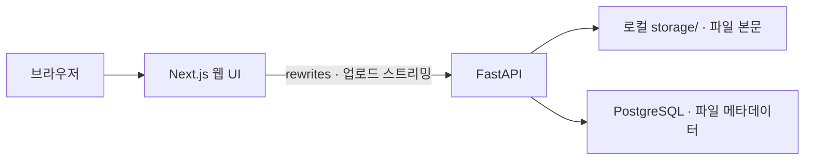

# Nestside

**AI 기반 지능형 개인 클라우드 스토리지 시스템**

Nestside는 Ubuntu 개인 서버에 파일을 저장하고 웹에서 관리하는 개인 클라우드 프로젝트입니다.
파일 관리 기능을 바탕으로 PC 자동 동기화와 AI Storage Assistant를 순차적으로 추가해,
자연어로 파일을 찾고 저장공간을 관리할 수 있는 시스템을 목표로 합니다.
현재는 웹 파일 관리 기능을 구현했으며, 동기화와 AI 기능은 개발 예정입니다.

## 프로젝트 배경

대학교 IoT 시스템 설계 과목의 프로젝트로, 개인 서버의 저장공간을 여러 PC에서 편리하게
활용하기 위해 시작했습니다. 파일 본문과 메타데이터를 직접 관리하는 기반을 만들고,
향후 동기화와 AI 기능을 연결합니다. 개발 과정에서는 생성형 AI와 협업 개발 도구를 활용합니다.

## 주요 기능과 개발 현황

| 상태 | 기능 | 내용 |
| --- | --- | --- |
| 구현 완료 | 파일 업로드 | 단일 파일 전송, 중복 이름 방지, 크기·SHA-256 계산 |
| 구현 완료 | 파일 목록 조회 | 파일명·크기·업로드 시각 표시, 파일 수와 목록의 전체 용량 집계 |
| 구현 완료 | 파일 다운로드 | 한글·특수문자 파일명 인코딩과 브라우저 다운로드 연동 |
| 구현 완료 | 파일 삭제 | ID 기반 API, 파일명·복구 경고 확인창, 성공 후 목록·용량 갱신 |
| 구현 완료 | 메타데이터 관리 | PostgreSQL에 파일 정보 저장, 파일 작업 잠금과 복구 기록 관리 |
| 개발 예정 | PC 자동 동기화 | PC와 서버 사이 파일 변경 감지·동기화 및 충돌 처리 |
| 개발 예정 | AI Storage Assistant | 자연어 파일 검색과 저장공간 분석·관리 지원 |
| 개발 예정 | 인증·보안 강화 | 사용자 인증, 파일 소유권·권한 검사 |

분할 업로드와 중단 전송 재개는 아직 구현되지 않았습니다. SHA-256 계산과 서버 측
메타데이터 비교는 구현했지만, 클라이언트가 제공한 기대 해시 검증은 제공하지 않습니다.
상세 진행 상황과 로드맵은 [개발 현황](docs/PROJECT_STATUS.md)에 정리합니다.

## 시스템 아키텍처



브라우저는 Next.js의 같은 출처 API 경로를 호출하고, Next.js는 Ubuntu 내부의
`127.0.0.1:8000`으로 전달합니다. 업로드는 내부 스트리밍 핸들러를 사용하며,
프론트엔드가 PostgreSQL에 직접 접속하지 않습니다.

## 기술 스택

| 영역 | 기술 |
| --- | --- |
| 서버 환경 | Ubuntu, 로컬 파일시스템 |
| 백엔드 | Python, FastAPI, Uvicorn, psycopg |
| 데이터베이스 | PostgreSQL |
| 프론트엔드 | Next.js, React, TypeScript, Tailwind CSS |
| 검증 | Python unittest, Vitest, Testing Library, Playwright |
| 버전 관리 | Git, GitHub |

## 개발 환경 실행

**현재 버전은 인증이 없는 내부망 개발용입니다. 인터넷 공개용으로 사용하지 마세요.**
삭제 API는 기본 비활성화되어 있으며, 아래 실행 예시도 그 상태를 유지합니다.
삭제 활성화 조건과 파일 잠금·장애 복구 절차는 [파일 작업 안내](docs/FILE_OPERATIONS.md)를 참고하세요.

아래 명령은 의존성과 DB가 준비된 개발 환경을 기준으로 합니다. Python 가상환경의
백엔드 의존성, PostgreSQL의 files 테이블, 프로젝트 루트 .env의 DB_HOST·DB_PORT·DB_NAME·
DB_USER·DB_PASSWORD 설정이 필요합니다. 현재 저장소에는 백엔드 의존성 고정 파일과
DB 자동 초기화 절차가 없습니다. 기존 DB를 임의로 초기화하거나 비밀정보를 문서·Git에 넣지 마세요.

### 1. FastAPI 실행

프로젝트 루트의 터미널에서 실행합니다. 이미 8000 포트에서 실행 중이면 중복 실행하지 마세요.

```bash
NESTSIDE_ENABLE_DELETE=false .venv/bin/python -m uvicorn backend.main:app --host 127.0.0.1 --port 8000
```

### 2. 웹 UI 실행

별도 터미널에서 Node.js 22 이상을 사용합니다. 현재 개발 서버에 준비한 로컬 런타임을
사용한다면 아래 PATH 설정을 적용하세요. .runtime은 Git에 포함하지 않으며, 새 환경의
런타임 준비 방법은 [프론트엔드 안내](frontend/README.md)에 있습니다.

```bash
cd frontend
export PATH="$PWD/.runtime/node_modules/.bin:$PATH"
npm ci
npm run dev
```

기본 웹 개발 서버는 `0.0.0.0:3000`에서 실행됩니다. Ubuntu에서는 `http://localhost:3000`,
같은 내부망의 Windows에서는 `http://<Ubuntu 서버 IP>:3000`으로 접속합니다.
현재 개발 서버 IP가 유지된다면 `http://172.30.1.46:3000`을 사용할 수 있습니다.
기존 수동 통합 테스트에서는 별도 13000 포트를 사용했으며, 기본 실행 포트와 구분합니다.

## 검증과 참고 문서

최근 검증에서는 프론트엔드 55개, Chromium 브라우저 17개, 백엔드 40개 테스트를 통과했습니다.
Windows 브라우저에서 승인된 테스트 파일을 삭제한 뒤 실제 파일·PostgreSQL 기록 제거와
기존 두 파일의 보존도 확인했습니다. GB급·동시 대용량 성능과 일반적인 운영 장애까지
검증한 결과는 아닙니다.

- [개발 현황과 로드맵](docs/PROJECT_STATUS.md)
- [프론트엔드 실행·격리 테스트·사용 안내](frontend/README.md)
- [삭제 API 활성화·파일 잠금·장애 복구 상세 안내](docs/FILE_OPERATIONS.md)
- [AI 협업 개발 규칙](AGENTS.md)
